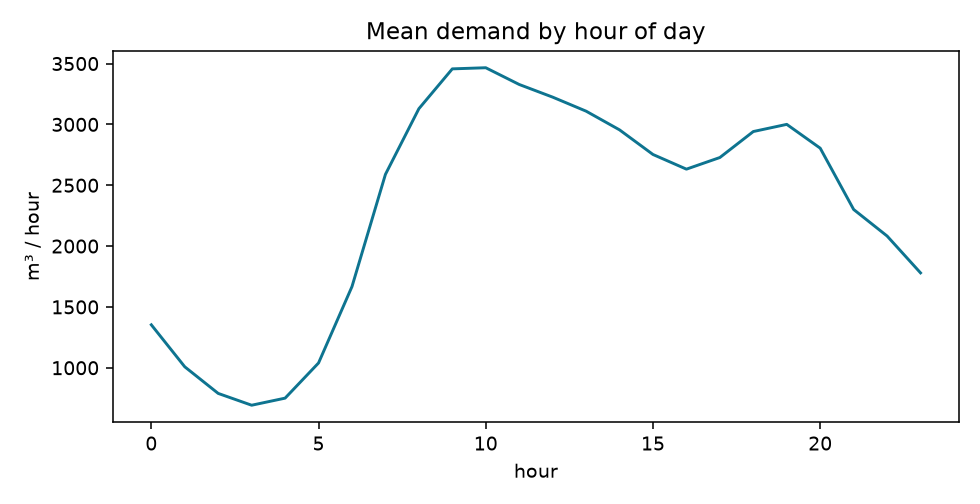
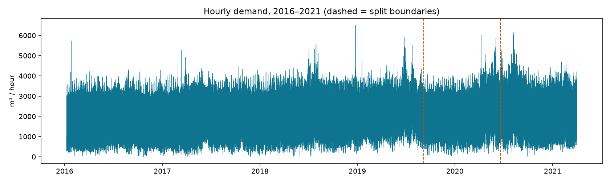
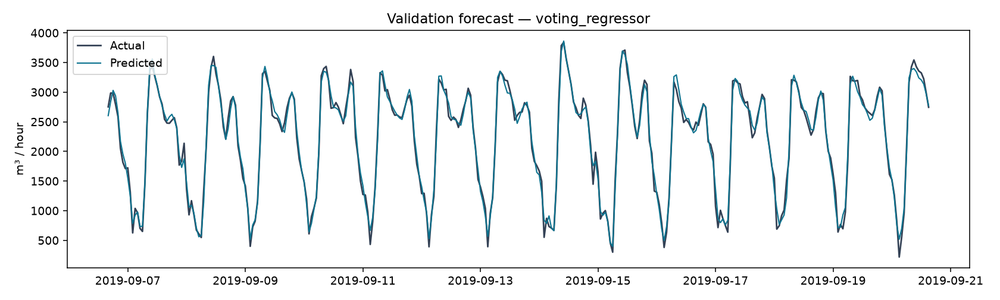

# Hourly Water Demand Forecasting

One-hour-ahead forecast of aggregate water demand for a mixed residential /
commercial / industrial district, built on **45,864 hours of real operational
data** (2016–2021) from a German regional water supplier — not a synthetic series.

**Headline:** 158.3 m³ MAE on 6,880 unseen hours (**R² 0.9588**), which is a
**44% reduction in absolute error** against the seasonal-naive baseline
(282.7 m³). The model was chosen on validation data *before* the test block was
opened.

[](https://streamlit.io)


---

## Problem

A utility pumping station must decide, every hour, how much water to move and
store. Better forecasts mean fewer pump start/stops, lower energy cost and less
unnecessary storage. The task is **one-hour-ahead** demand forecasting from
demand history, calendar position and *lagged* weather observations.

## Data

| | |
|---|---|
| Source | *Hourly Water Demand of a Mixed District Recorded by Supplier* |
| Publisher | Siemens AG, collected for a study at KIT |
| Zenodo record | `11045013` |
| DOI | [10.5281/zenodo.11045013](https://doi.org/10.5281/zenodo.11045013) |
| License | CC-BY-4.0 |
| Raw rows | 46,032 hourly observations |
| Usable rows | **45,864** after the 168-hour feature warm-up |
| Span | 2016-01-01 00:00 → 2021-04-01 23:00 |
| Columns | `Date, Time, Consumption, Temperature, Rain, Sun` |
| Synthetic data | **No** |

`scripts/download_data.py` fetches the CSV and verifies a pinned SHA-256, so a
swapped or edited file fails loudly instead of training silently.

## Data quality and domain findings

Four properties of this series shaped every modelling decision. All of them are
computed by `scripts/data_quality.py` into `reports/data_quality.json` — nothing
here is hand-entered.

### 1. 48 sensor-dropout hours below 100 m³

Median hourly consumption is **2,550 m³**; the minimum recorded value is **1 m³**
(2016-10-23 05:00). 48 hours fall below 100 m³ and 547 below 300 m³.

| Timestamp | Consumption |
|---|---:|
| 2016-10-23 05:00 | 1 m³ |
| 2017-04-06 02:00 | 5 m³ |
| 2016-10-20 04:00 | 6 m³ |
| 2017-04-14 05:00 | 7 m³ |
| 2016-09-05 03:00 | 8 m³ |
| 2017-11-26 05:00 | 10 m³ |

These are telemetry faults, not demand troughs — the genuine intraday minimum is
about 692 m³ at 03:00. They cluster in the **02:00–05:00** low-flow window, when
loggers are most likely to be serviced or to under-read.

**Impact.** Each bad value contaminates seven lag features and up to 168 hours of
rolling statistics, so one dropout degrades a week of subsequent predictions.
They are 0.10% of rows and therefore invisible in aggregate MAE — which is
exactly why they are documented rather than silently smoothed. They are left in
place: deleting them would break the contiguity the lag structure depends on, and
the 2,550 m³ prior is far better than anything the neighbouring 03:00 hours could
supply.

### 2. Rain is zero in 96.8% of hours

The ordered `rain_intensity` feature has one dominant class, so the encoding is
correct in principle (the ordering is physical, so ordinal beats one-hot) but
carries almost no information. Permutation importance confirms it: no weather
feature reaches the top eight. Any claim that rain intensity drives demand on
this dataset would be unsupported.

### 3. A +20.7% upward trend, and it shows up as forecast bias

Mean hourly demand rises from **2,097 m³** (2016) to **2,534 m³** (2020). Because
the split is chronological, the test block sits above the range the model was
trained on. The consequence is measurable: the final model **under-forecasts by
27.7 m³ on average** and does so on **56% of hours**.

That is a clean demonstration of distribution shift, and the right response is a
rolling refit — not a constant offset, which would only hide the drift.

### 4. Demand swings 5× within a day — which is why lag-1 is a weak baseline

| Hour | Mean demand |
|---|---:|
| 03:00 | 692 m³ |
| 09:00 | 3,456 m³ |
| 10:00 | 3,465 m³ |
| 22:00 | 2,083 m³ |



*A 5× swing between the 04:00 trough and the 10:00 peak. This is the shape any
one-hour-ahead model has to track.*

The autocorrelation ladder explains the whole baseline choice:

| Lag | Autocorrelation |
|---|---:|
| 1 h | 0.9012 |
| 3 h | 0.4805 |
| 24 h | 0.9122 |
| 168 h | **0.9287** |

Same-hour-last-week correlates better than hour-to-hour, because lag-1 is
contaminated by the *direction of travel* within the day. Hence `lag_168` is both
a feature and the honest baseline.


## Results

Chronological 70 / 15 / 15 split — 32,104 / 6,880 / 6,880 rows. No shuffling.



*Five years of hourly demand. The dashed lines are the train/validation and
validation/test boundaries. The five-fold intraday oscillation and the upward
drift are both visible before any modelling.*

### Validation block (this is what selection used)

| Model | MAE | RMSE | R² | sMAPE |
|---|---:|---:|---:|---:|
| **voting_regressor** | **148.97** | **206.12** | **0.9595** | **8.91%** |
| xgboost | 150.06 | 207.58 | 0.9589 | 8.92% |
| bagging_extra_tree | 153.90 | 211.63 | 0.9573 | 9.26% |
| random_forest | 153.05 | 212.87 | 0.9568 | 9.21% |
| hist_gradient_boosting | 154.70 | 214.52 | 0.9561 | 9.27% |
| ridge_yj_robust | 190.40 | 256.71 | 0.9371 | 11.39% |
| naive_lag_168 | 276.01 | 402.75 | 0.8452 | 15.00% |
| naive_lag_24 | 291.24 | 427.06 | 0.8259 | 16.20% |
| naive_lag_1 | 336.09 | 454.73 | 0.8026 | 19.78% |

Two further candidates were benchmarked on the same block:

| Model | Family | MAE | R² | sMAPE |
|---|---|---:|---:|---:|
| tuned_xgboost | 30-trial Optuna, train-only | 150.82 | 0.9581 | 8.99% |
| keras_mlp | 15-trial Keras Tuner, 2×64 | 173.53 | 0.9467 | 10.40% |

Neither displaced the ensemble, and the tuned XGBoost is **0.76 m³ worse** than
the untuned one it was derived from. That is the expected result once the search
stops peeking at the validation block — it is written up in `docs/PARITY.md`
rather than omitted.



*Two weeks of validation forecasts. The model tracks the daily cycle closely; the
visible misses are the sharp upward ramps at 06:00–08:00, where one hour of
history is least informative about the next.*

### Locked test — opened exactly once

| Model | Role | MAE | RMSE | R² | sMAPE |
|---|---|---:|---:|---:|---:|
| **voting_regressor** | selected | **158.26** | **220.99** | **0.9588** | **8.32%** |
| naive_lag_168 | baseline | 282.72 | 407.03 | 0.8601 | 13.58% |
| naive_lag_24 | baseline | 286.14 | 427.59 | 0.8456 | 14.45% |
| naive_lag_1 | baseline | 363.44 | 482.06 | 0.8038 | 19.58% |

### Why lag-168 is the right baseline

It is tempting to headline a 4× improvement against `naive_lag_1`. That would be
dishonest. Intraday demand oscillates, so hour-to-hour persistence is *weak*:
measured autocorrelation is 0.901 at lag 1 but **0.929 at lag 168**. LightGBM-
free comparison, same test block:

```
lag-1 persistence MAE   363.4   ← weak baseline
lag-168 persistence     282.7   ← honest baseline
voting ensemble         158.3   ← 44.0% better
```

### Cross-validation

`TimeSeriesSplit`, 5 expanding folds over train+validation, every transformer
refit inside each fold. The voting ensemble **is included** — the reference
implementation left it out, which is why this table is the stronger evidence.

| Model | CV MAE | ± std | RMSE | R² | sMAPE |
|---|---:|---:|---:|---:|---:|
| **voting_regressor** | **152.78** | ±16.74 | **213.97** | **0.9542** | **9.74%** |
| xgboost | 155.93 | ±15.49 | 218.13 | 0.9524 | 9.89% |
| bagging_extra_tree | 156.84 | ±19.67 | 218.71 | 0.9520 | 10.09% |
| hist_gradient_boosting | 157.25 | ±16.19 | 219.62 | 0.9518 | 9.98% |

The ensemble wins CV as well as validation, so the selection is not an artefact
of one lucky window. The ±16–20 m³ spread across folds is larger than the 1–3 m³
gaps between models, and that is stated plainly: these four are close, and the
ensemble is preferred for robustness under distribution shift rather than because
it is decisively better.

## Methodology

```
download+verify → causal features → baselines → ensembles → tuning → freeze → locked test
```

- **Causal features.** Demand lags 1/2/3/24/48/72/168 h; past-only rolling
  mean/std/min/max over 3/24/168 h; EWM at span 6/24. Every one is computed from
  `y.shift(1)` or stricter — never from `y`.
- **Weather is lagged.** Only `lag_1` and `lag_24`. Using the target hour's
  observation would be leakage, because a utility never has it at decision time.
- **Calendar** features are known a priori: hour/day/month with sine–cosine
  encoding, weekend flag, season, hour-period.
- **Two preprocessing branches.** Scale-sensitive models (Ridge, MLP) get
  `median impute → Yeo-Johnson → RobustScaler`. Tree models get imputation and
  categorical encoding only — no scaling, because trees do not need it and
  pretending otherwise is decoration.
- **Encoders matched to type.** OneHot for nominal (`day_of_week_name`,
  `season`, `hour_period`), Ordinal only where the ordering is physical
  (`rain_intensity`: none < light < moderate < heavy), 0/1 for binary.
- **Selection frozen before testing.** `reports/selection.json` is written first;
  `train.locked_test()` refuses to run if it is missing or if the requested model
  does not match the frozen choice.

### Four fixes over the reference implementation

This project reproduces the reference pipeline's numbers (see
`docs/PARITY.md`) but deliberately departs from it in four places:

1. **Tuning no longer contaminates the validation score.** The reference searched
   Optuna's CV over `train + validation` and then scored the winner on
   `validation`, inflating it while its rivals stayed honest. Here the search sees
   training rows only.
2. **The selected model participates in CV.** The reference explicitly excluded
   the voting ensemble from cross-validation, leaving the headline model with a
   single validation window as evidence.
3. **Every limited-history check is tested.** `tests/test_no_leakage.py` includes
   a *truncate-the-future* test: features at time *t* must be byte-identical
   whether or not later rows exist.
4. **Deployment is a first-class deliverable**, not an afterthought.

## Project structure

```
water-demand-forecasting/
├─ app.py                       Streamlit application (5 tabs)
├─ src/waterdemand/
│  ├─ config.py                 paths, seed, split, feature contract
│  ├─ data.py                   Zenodo download + SHA-256 + audit
│  ├─ features.py               causal feature engineering
│  ├─ preprocessing.py          scale-sensitive vs tree branches
│  ├─ models.py                 the 8-regressor registry + persistence baselines
│  ├─ splits.py                 chronological split
│  ├─ train.py                  stages, selection freeze, locked test
│  ├─ evaluate.py               TimeSeriesSplit CV, segments, residuals
│  ├─ tuning.py                 Optuna + Keras Tuner (train-only search)
│  └─ inference.py              one-hour-ahead from a history window
├─ scripts/
│  ├─ download_data.py          fetch + verify
│  ├─ data_quality.py           the §Data quality numbers
│  ├─ tune.py                   Optuna + Keras Tuner (run once, then reuse)
│  ├─ train_all.py              end-to-end run
│  └─ make_report.py            permutation importance + figures
├─ tests/test_no_leakage.py     13 causal/leakage assertions
├─ tests/test_app.py            4 headless AppTest smoke tests
├─ docs/PARITY.md               reproduction vs the reference implementation
├─ reports/PROJECT_REPORT.md    full narrative write-up
├─ models/                      voting_regressor.joblib, xgboost.joblib, metadata
└─ reports/                     metrics.json, split.json, importance.csv, figures
```

## Quickstart

```bash
python -m venv .venv && .venv\Scripts\activate      # Windows
pip install -r requirements-dev.txt

python scripts/download_data.py                    # fetch + verify ~1.7 MB
python -m pytest -q                                # 17 tests: 13 leakage + 4 app
python scripts/data_quality.py                     # the findings above
python scripts/tune.py                             # Optuna + Keras Tuner (slow, run once)
python scripts/train_all.py --reuse-tuning         # baselines → ensembles → CV → locked test
python scripts/make_report.py                      # importance + figures
streamlit run app.py
```

`train_all.py` runs in ~4 minutes on CPU and omits tuning with `--skip-tune`.
Tuning is separated into `tune.py` because it is the slow stage and its results
are reused via `--reuse-tuning` — the pipeline stays idempotent.

## The app

Five tabs, all reading pre-computed artefacts — nothing trains at request time:

| Tab | What it shows |
|---|---|
| **Forecast** | pick a target hour, get a one-hour-ahead prediction with the persistence anchors beside it |
| **Backtest** | actual vs predicted over the locked-test window, MAE by hour of day, residual distribution, under-forecast rate |
| **Models** | the full leaderboard — validation, CV and locked test side by side |
| **Drivers** | permutation importance |
| **Methodology** | split geometry, data audit, and the leakage-control table |

### Deploying to Streamlit Community Cloud

1. Push the repo (the two `.joblib` files are committed: 25.5 MB and 1.6 MB).
2. Create the app at [share.streamlit.io](https://share.streamlit.io), entry point `app.py`.
3. Keep `requirements.txt` as-is. **It deliberately excludes TensorFlow** — the
   MLP lost the benchmark and would not fit the free tier's 1 GB RAM.

Deployment gotchas this project already handles:

- **No CUDA in the pickle.** The reference builder hard-set `device="cuda"` on
  XGBoost, which crashes on a GPU-less host. `models.make_xgboost()` defaults to
  `device="cpu"` so saved boosters load anywhere.
- **Pinned versions.** An unpickle against a different scikit-learn or XGBoost
  minor version is the number-one cause of a blank Streamlit app.
- **Artifact size.** The 70-tree bagging member compresses to 25.5 MB. The
  `xgboost` alternative is 1.6 MB and is selectable in the sidebar.

## Limitations

- **Research prototype, not a deployed utility system.** No SLA, no retraining
  schedule, no monitoring.
- **Lagged weather, not forecast weather.** In production the weather inputs must
  come from a forecast feed; the current model reads the previous hour's
  observation, which is a reasonable proxy and nothing more.
- **Distribution shift.** The test block is 2020-06 → 2021-04, i.e. a pandemic
  period, and demand trends upward across the whole series. A production system
  should refit on a rolling window.
- **No prediction intervals.** Point forecasts only; the Backtest tab exposes the
  90% empirical error band as a stand-in.
- **Single series.** One district. Multi-site generalisation is untested.

## Reproducibility

Library versions move, and tree ensembles are not bit-identical across
scikit-learn or XGBoost releases. This build reproduces the reference metrics to
within **0.01 m³ MAE** and **0.0002 sMAPE** on the locked test; see
`docs/PARITY.md` for the side-by-side table and the exact cause of the residual
gap.

## License

Code: MIT. Data: CC-BY-4.0, © Siemens AG / KIT.
