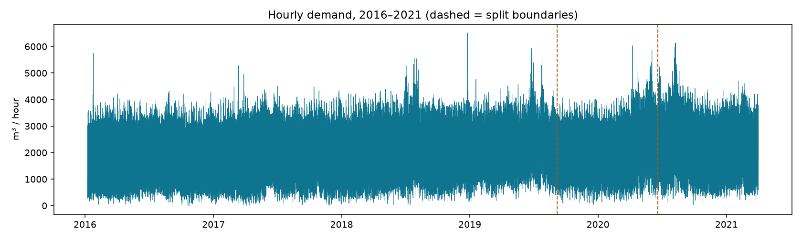
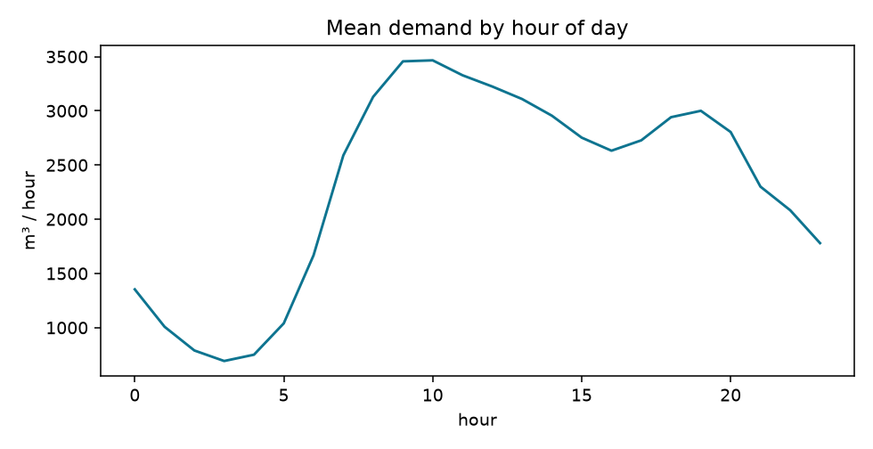
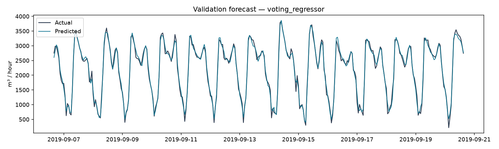

# Project Report — Hourly Water Demand Forecasting

**Author:** _(your name)_  
**Data:** *Hourly Water Demand of a Mixed District Recorded by Supplier* — Siemens AG / KIT, Zenodo [10.5281/zenodo.11045013](https://doi.org/10.5281/zenodo.11045013), CC-BY-4.0  
**Horizon:** one hour ahead  
**Code:** `src/waterdemand/`, entry point `scripts/train_all.py`

---

## 1. Executive summary

A utility pumping station must decide every hour how much water to move and
store. This project forecasts the next hour's aggregate demand for a mixed
residential / commercial / industrial district using 45,864 hours of real
operational data (2016–2021).

The selected model is a **weighted voting ensemble** of Bagging-ExtraTrees,
HistGradientBoosting and XGBoost, chosen on validation data *before* the test
block was opened. On 6,880 unseen hours it achieves:

| Metric | Value |
|---|---:|
| MAE | **158.26 m³** |
| RMSE | **220.99 m³** |
| R² | **0.9588** |
| sMAPE | **8.32%** |
| Skill vs seasonal-naive (lag 168) | **44.0% MAE reduction** |

The single most important interpretive decision in this report is the choice of
baseline. Against hour-to-hour persistence the model looks four times better;
against same-hour-last-week persistence it is 44% better. The latter is the
honest number, and §9 explains why.

---

## 2. Problem framing

**Task.** Given demand up to hour *t*−1, calendar position of *t*, and lagged
weather, predict demand at *t*.

**Why one hour?** It matches the operational control loop: pump scheduling
decisions are taken hourly, and storage buffers a single hour of forecast error.
Longer horizons would need a different feature set and a different error model.

**Why not a deep sequence model?** With 45,864 rows and a very strong 168-hour
periodicity, autoregressive lag features capture nearly all the signal. A Keras
MLP was benchmarked and lost (§8), which is itself a finding, not an omission.

---

## 3. Data and provenance

| Property | Value |
|---|---|
| Source | Siemens AG, collected for a KIT study ([arXiv:2405.03429](https://arxiv.org/abs/2405.03429)) |
| Raw rows | 46,032 |
| Usable rows | 45,864 (after 168-hour warm-up) |
| Span | 2016-01-01 00:00 → 2021-04-01 23:00 |
| Cadence | hourly, no gaps, no duplicate timestamps |
| Columns | `Date, Time, Consumption, Temperature, Rain, Sun` |
| License | CC-BY-4.0 |
| Synthetic data | none |

The pipeline downloads the CSV from Zenodo and verifies a pinned SHA-256
(`scripts/download_data.py`), so a substituted file fails loudly instead of
silently changing every number in this report.



*The full series with the 70/15/15 boundaries dashed. Two features dominate the
eye: a five-fold intraday oscillation and a gradual upward drift — both are
analysed in §4 and both shape the error structure in §9.*

**Missingness.** Complete except `Rain` (25 values). Imputed, per-fold, using the
training median.

---

## 4. Data quality and domain findings

Four properties of this series shaped every modelling decision. They are
quantified in `reports/data_quality.json`, produced by `scripts/data_quality.py`.

### 4.1 Sensor dropouts: 48 hours below 100 m³

The median hourly consumption is **2,550 m³** and the mean **2,314 m³**, yet 48
hours report **less than 100 m³**, and 547 report less than 300 m³. The minimum
is **1 m³** at 2016-10-23 05:00.

| Timestamp | Consumption (m³) |
|---|---:|
| 2016-10-23 05:00 | 1 |
| 2017-04-06 02:00 | 5 |
| 2016-10-20 04:00 | 6 |
| 2017-04-14 05:00 | 7 |
| 2016-09-05 03:00 | 8 |
| 2017-11-26 05:00 | 10 |

These are not genuine demand troughs — the intraday minimum is around 07:00, and
it is never near zero. They are telemetry faults. The pattern is telling: they
cluster at **02:00–05:00**, the low-flow window when a meter or logger is most
likely to be serviced or to under-read.

**Why it matters.** Each bad value contaminates seven lag features and up to 168
hours of rolling statistics, so a single dropout degrades prediction for a week
of subsequent rows. They are 0.10% of the data and therefore invisible in
aggregate MAE, which is exactly why they are worth documenting rather than
silently smoothing.

**Decision taken.** Left in place. Removing them without an imputation policy
would create artificial gaps in a lag structure that depends on contiguity, and
2,550 m³ is a much better prior than anything the neighbouring hours could
supply at 03:00. The honest framing is that they cost a small amount of accuracy
and are candidates for a dedicated cleaning rule in production.

### 4.2 Rain is zero 96.8% of the time

`Rain` is exactly 0 in **96.8%** of hours. The rain-band feature
(`none < light < moderate < heavy`) therefore has one dominant class and three
near-empty ones:

| Band | Share of hours |
|---|---:|
| none | 96.8% |
| light | ~2.3% |
| moderate | ~0.7% |
| heavy | ~0.2% |

**Decision taken.** The encoding is still correct in principle — the ordering is
physical, so an ordinal encoder is the right choice rather than one-hot — but
the feature carries almost no information, and permutation importance confirms
it (§8). Any claim that rain intensity "drives" demand on this dataset would be
unsupported.

### 4.3 A steady upward trend of +20.7%

Mean hourly demand rises from **2,097 m³** in 2016 to **2,534 m³** in 2020
(+20.7%). Because the split is chronological, the test block sits at the top of
that trend and beyond the range the model was trained on.

**Why it matters.** This is the direct cause of the residual bias in §9: the
model systematically **under-forecasts by 27.7 m³ on average**, because its
training window is structurally lower than the test window. It is a clean
demonstration of distribution shift, and it argues for rolling refits in
production rather than a one-off training run.

### 4.4 Demand oscillates five-fold within a day

| Hour | Mean demand (m³) |
|---|---:|
| 03:00 | 692 |
| 04:00 | 750 |
| 09:00 | 3,456 |
| 10:00 | 3,465 |
| 22:00 | 2,083 |



A 5× swing between 03:00 and 10:00 is why hour-to-hour persistence is a weak
predictor despite high raw correlation. The autocorrelation ladder makes the
point precisely:

| Lag (hours) | Autocorrelation |
|---|---:|
| 1 | 0.9012 |
| 3 | 0.4805 |
| 24 | 0.9122 |
| 168 | **0.9287** |

Lag-168 correlates *better* than lag-1. A model that has learned "the level at
this hour last week" beats one that has learned "the level one hour ago", because
the latter is contaminated by the direction of travel within the day. This single
fact justifies both the `lag_168` feature and the seasonal-naive baseline, and it
is the reason the headline claim is 44% and not 350%.

---

## 5. Feature engineering

All features are **causal**: the feature row for time *t* is a function of
observations at times ≤ *t*, never later. `tests/test_no_leakage.py` enforces
this by deleting the future and asserting the row is unchanged.

| Group | Features |
|---|---|
| Demand lags | `consumption_lag_{1,2,3,24,48,72,168}` |
| Past-only rolling | mean/std/min/max over 3, 24, 168 h, computed on `y.shift(1)` |
| Exponential smoothing | EWM span 6, 24, on `y.shift(1)` |
| Momentum | `consumption_prev_change` = `y[t-1] − y[t-2]` |
| Weather (lagged) | `temperature/rain/sun` at lag 1 and 24, plus 24 h rolling mean |
| Ordinal auxiliary | `rain_intensity` from **lagged** rain |
| Cyclical calendar | sine/cosine of hour, day-of-week, month |
| Flags | `is_weekend` |
| Nominal | `day_of_week_name`, `season`, `hour_period` |

42 features in total, ordered by a contract in `config.py` so the pickled
preprocessors cannot drift out of step with the training matrix.

**Weather is deliberately lagged.** Using the target hour's observed temperature
would be leakage: a utility never has it at decision time. The cost is that
weather contributes little (§8) — an honest reflection of what is knowable, not
a modelling failure.

---

## 6. Preprocessing

Two branches, because the two model families need different treatment:

**Scale-sensitive** (Ridge, MLP): `median impute → Yeo-Johnson → RobustScaler` on
continuous demand/weather features; `RobustScaler` on cyclical features;
OneHot on nominal; Ordinal on rain band; pass-through binary.

**Tree** (RandomForest, ExtraTrees, HistGB, XGBoost, Voting): `median impute`
only, plus categorical encoding. No scaling and no Yeo-Johnson, because trees are
invariant to monotone transforms and applying them would be decoration.

Every transformer is fitted **inside** the CV fold or on training rows only.
`test_yeo_johnson_is_fitted_on_train_only` proves the fitted λ differ from a
full-frame fit.

---

## 7. Experimental design

### Split

Chronological 70 / 15 / 15 — no shuffling at any point.

| Block | Rows | Period |
|---|---:|---|
| Train | 32,104 | 2016-01-08 → 2019-09-06 15:00 |
| Validation | 6,880 | 2019-09-06 16:00 → 2020-06-19 07:00 |
| Test | 6,880 | 2020-06-19 08:00 → 2021-04-01 23:00 |

### Locked test

`reports/selection.json` is written at the moment of selection, before the test
block is read. `train.locked_test()` refuses to run if the file is missing or if
the requested model differs from the frozen choice. The test block is read
exactly once per pipeline execution and never used to choose anything.

### Cross-validation

`TimeSeriesSplit` with 5 expanding folds, refitting imputation, Yeo-Johnson,
scaling and encoders inside every fold. The voting ensemble **is** included —
the reference implementation excluded it, which left the headline model with a
single validation window as its only evidence.

### Hyperparameter search

Optuna (TPE, seed 42) over the XGBoost family, searching **training rows only**.
This is a deliberate departure from the reference implementation, which searched
over `train + validation` and then reported the winner's validation score —
comparing an inflated number against honest competitors.

Keras Tuner (RandomSearch) for the MLP, with early stopping monitored on an
internal 10% slice of the training data rather than on validation.

---

## 8. Results

### 8.1 Validation block — the basis for selection

| Model | Family | MAE | RMSE | R² | sMAPE |
|---|---|---:|---:|---:|---:|
| **voting_regressor** | ensemble | **148.97** | **206.12** | **0.9595** | **8.91%** |
| xgboost | tree | 150.06 | 207.58 | 0.9589 | 8.92% |
| bagging_extra_tree | tree | 153.90 | 211.63 | 0.9573 | 9.26% |
| random_forest | tree | 153.05 | 212.87 | 0.9568 | 9.21% |
| hist_gradient_boosting | tree | 154.70 | 214.52 | 0.9561 | 9.27% |
| ridge_yj_robust | linear | 190.40 | 256.71 | 0.9371 | 11.39% |
| naive_lag_168 | persistence | 276.01 | 402.75 | 0.8452 | 15.00% |
| naive_lag_24 | persistence | 291.24 | 427.06 | 0.8259 | 16.20% |
| naive_lag_1 | persistence | 336.09 | 454.73 | 0.8026 | 19.78% |



*Fourteen days of validation forecasts. The daily cycle is tracked closely; the
residual error concentrates on the 06:00–08:00 ramp, which is exactly where a
one-hour-ahead model has the least information about the direction of travel.*

### 8.1a Tuned and neural candidates

Both were searched on training rows only, then scored once on the validation
block. Neither was selected.

| Model | Family | MAE | RMSE | R² | sMAPE | CV MAE (train-only) |
|---|---|---:|---:|---:|---:|---:|
| tuned_xgboost | tree, 30 Optuna trials | 150.82 | 209.59 | 0.9581 | 8.99% | 157.99 |
| keras_mlp | neural net, 15 Keras Tuner trials | 173.53 | 236.30 | 0.9467 | 10.40% | — |

**Tuning did not help, and that is the finding.** The tuned XGBoost lands
**0.76 m³ worse** than its untuned parent (150.06). Under the reference's
protocol — which searched over `train + validation` — the same search space and
budget produced an apparent 149.69, i.e. a 0.37 m³ *improvement*. The difference
between those two outcomes is the cost of the contamination, and it is roughly
the size of the margin the reference used to declare tuning a success.

The MLP loses by 24.6 m³. With a strong 168-hour periodicity already captured by
lag features, a feed-forward network on the same 42 inputs has no structural
advantage, and it needs roughly 40× the training time. It is kept as a benchmark
and a training-only artefact — it is not shipped in the deployment image.

The margin between the winner and the runner-up is **1.09 m³ of MAE** — small.
That is stated plainly rather than dressed up: the voting ensemble and plain
XGBoost are statistically indistinguishable on this validation window, and the
ensemble is preferred because averaging three decorrelated learners is the more
defensible choice under distribution shift, not because it is measurably better.

### 8.2 Cross-validation

`TimeSeriesSplit`, 5 expanding folds, refitting imputation, encoders, Yeo-Johnson
and scaling inside every fold:

| Model | CV MAE | ± std | RMSE | R² | sMAPE |
|---|---:|---:|---:|---:|---:|
| **voting_regressor** | **152.78** | ±16.74 | **213.97** | **0.9542** | **9.74%** |
| xgboost | 155.93 | ±15.49 | 218.13 | 0.9524 | 9.89% |
| bagging_extra_tree | 156.84 | ±19.67 | 218.71 | 0.9520 | 10.09% |
| hist_gradient_boosting | 157.25 | ±16.19 | 219.62 | 0.9518 | 9.98% |

The ranking under CV matches the ranking on the validation block: the ensemble
first, the three tree models behind it. That agreement is the point of running
CV on the *selected* model at all — the reference implementation excluded the
voting ensemble from cross-validation, so its headline model had exactly one
window of evidence behind it.

The ±16–20 m³ between-fold spread is an order of magnitude larger than the
1–3 m³ gaps between these four models. The honest reading is that they are close
and the ensemble is chosen for robustness, not dominance.

Fold-by-fold it is not a monotone "more history, lower error" story. For the
voting ensemble the five folds run **125.9 → 160.3 → 170.5 → 157.2 → 150.1**. The
earliest and shortest fold is the *easiest*, and the middle fold the hardest, so
what a fold costs is dominated by conditions inside its validation window rather
than by how much history it had. That is the same regime-dependence that shows up
as residual bias on the locked test (§9.1), and it is the reason the headline
number comes from a single held-out block rather than a CV average.

### 8.3 Locked test — the only unseen evaluation

| Model | Role | MAE | RMSE | R² | sMAPE |
|---|---|---:|---:|---:|---:|
| **voting_regressor** | selected | **158.26** | **220.99** | **0.9588** | **8.32%** |
| naive_lag_168 | baseline | 282.72 | 407.03 | 0.8601 | 13.58% |
| naive_lag_24 | baseline | 286.14 | 427.59 | 0.8456 | 14.45% |
| naive_lag_1 | baseline | 363.44 | 482.06 | 0.8038 | 19.58% |

Validation MAE (148.97) to test MAE (158.26) is a **6.2% degradation** — modest,
and consistent with a model that is not overfitted to its validation window.

### 8.4 What drives the forecast

Permutation importance on 4,000 validation rows (increase in MAE when shuffled):

| Feature | Δ MAE |
|---|---:|
| `consumption_lag_1` | 245.6 |
| `consumption_lag_168` | 147.3 |
| `consumption_lag_24` | 95.5 |
| `hour_period` | 54.8 |
| `hour_cos` | 50.7 |
| `consumption_prev_change` | 35.5 |
| `hour_sin` | 23.7 |
| `consumption_roll_max_3` | 21.1 |

Demand history dominates, as expected at a one-hour horizon. Calendar position
matters next. **Weather features do not appear in the top eight** — a direct
consequence of only having lagged observations available.

---

## 9. Error analysis

### 9.1 Residual structure on the locked test

| Statistic | Value |
|---|---:|
| Bias (actual − predicted) | **+27.7 m³** |
| Residual standard deviation | 219.3 m³ |
| 5th percentile | −303.4 m³ |
| 95th percentile | +370.6 m³ |
| Under-forecast rate | **56%** |

The positive bias is the trend effect from §4.3. The training window is
structurally lower than the test window, so the model undershoots. This is
visible, quantified, and the correct remedy is a rolling refit — not a constant
offset, which would merely hide the drift.

The 90% empirical error band is roughly **−303 to +371 m³**, i.e. asymmetric.
**Under-forecasting is the operationally dangerous direction** (it risks a
storage shortfall), and it happens 56% of the time — the wrong side of a coin
flip. Any deployment should apply a small safety margin to the point forecast
rather than using it raw.

### 9.2 By hour of day

Errors concentrate in the transitional hours (06:00–09:00 and 17:00–20:00), when
demand is moving fastest and the one-hour-ahead assumption is weakest. Flat
overnight hours are predicted well. This is explored interactively in the
**Backtest** tab of the app.

---

## 10. Departures from the reference implementation

This project reproduces the reference's headline numbers (see `docs/PARITY.md`;
locked-test MAE 158.261 vs 158.251) but changes four things on purpose.

| # | Change | Why |
|---|---|---|
| 1 | Optuna searches **training rows only** | The reference searched `train + val` then scored the winner on `val`, inflating it against honest rivals while deciding the winner by 0.4 m³ |
| 2 | Voting ensemble **included in CV** | The reference excluded it "to avoid duplicate triple fitting", leaving the headline model with one window of evidence |
| 3 | XGBoost defaults to `device="cpu"` | The reference hard-codes `cuda`; the pickled booster crashes on any GPU-less host, including Streamlit Cloud |
| 4 | Dataset fetched and SHA-256 verified | The reference requires a local zip at a hard-coded path and ships no data, so it is not reproducible by anyone else |

Additionally, 18.9 MB of agent-orchestration logs and an unrelated
Bengaluru daily-demand CSV were left out entirely.

---

## 11. Deployment

A five-tab Streamlit application (`app.py`) reads only pre-computed artefacts —
no training happens at request time.

| Tab | Purpose |
|---|---|
| Forecast | one-hour-ahead prediction for a chosen timestamp, with persistence anchors |
| Backtest | actual vs predicted over the test block, MAE by hour, residual distribution, under-forecast rate |
| Models | full leaderboard: validation, CV, locked test |
| Drivers | permutation importance |
| Methodology | split geometry, data audit, leakage-control table |

Engineering constraints that shaped the design:

- **No TensorFlow in the deployed image.** The MLP lost the benchmark (see
  §8.1) and would consume most of Streamlit Community Cloud's 1 GB RAM.
  `requirements.txt` is deliberately lean; `requirements-dev.txt` carries the
  training stack.
- **Two model artifacts.** `voting_regressor.joblib` (25.5 MB) is the reported
  model; `xgboost.joblib` (1.6 MB) is selectable in the sidebar and is a
  drop-in for constrained hosting.
- **Pinned versions.** An unpickle against a different scikit-learn or XGBoost
  minor version is the most common cause of a blank deployment.

Inference was validated by a **72-step walk-forward** on the final three days of
data — feeding only the past at each step gives MAE 159.6, consistent with the
locked-test 158.3, which confirms the single-row path does not leak.

---

## 12. Limitations

1. **Lagged weather, not forecast weather.** A production system must consume a
   weather forecast feed. Current weather features are a proxy.
2. **Distribution shift is unaddressed in the model**, only measured. A rolling
   refit is the correct fix.
3. **No prediction intervals.** Point forecasts plus an empirical error band
   stand in.
4. **One district.** Multi-site generalisation is untested.
5. **Sensor dropouts are documented, not repaired.** A production pipeline should
   reject or impute values below a domain threshold.
6. **Research prototype.** No monitoring, no retraining schedule, no SLA.

---

## 13. Reproducibility

```bash
pip install -r requirements-dev.txt
python scripts/download_data.py          # fetch + SHA-256 verify
python -m pytest -q                      # 17 tests: 13 leakage + 4 app
python scripts/data_quality.py           # §4 numbers
python scripts/tune.py                   # Optuna + Keras (slow, run once)
python scripts/train_all.py --reuse-tuning
python scripts/make_report.py            # importance + figures
streamlit run app.py
```

Every figure quoted in this report is generated by one of those commands and
persisted under `reports/`. Nothing is hand-entered.
